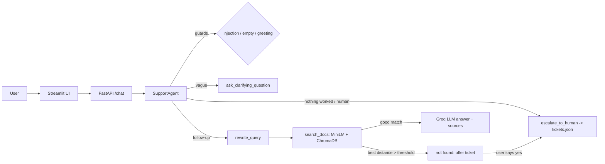

# Technical Support RAG Agent (Home Wi-Fi Router)

A support chatbot that answers router problems **only from your documentation**, cites its sources,
asks clarifying questions, and escalates to a human by creating a support ticket.
100% free stack: local embeddings + ChromaDB + Groq (free tier).

## Architecture



## Folder layout

```
data/raw/faqs/      27 FAQ documents (generated by make_faqs.py; add your own .md/.txt/.pdf)
src/ingest.py       load -> chunk -> embed -> store in ChromaDB
src/retrieve.py     vector search
src/generate.py     Groq answer, query rewriting, no-LLM fallback, prompt-injection rules
src/agent.py        the agent: 4 tools, memory, confidence check
src/storage.py      tickets.json and feedback.jsonl
app/api.py          FastAPI backend (/chat /health /tickets /feedback)
app/ui.py           Streamlit chat UI
ask.py              command-line chat
eval/               test_set.json (30 questions) + run_eval.py
tests/              pytest tests (offline)
```

## Setup (Windows PowerShell; Mac/Linux use `source venv/bin/activate`)

```powershell
python -m venv venv
venv\Scripts\activate
pip install -r requirements.txt
copy .env.example .env        # then put your GROQ_API_KEY in .env
python make_faqs.py           # creates the 27 documents
python src/ingest.py          # builds the vector database (downloads ~90 MB model once)
```

If Groq says "model not found", run `python list_models.py` and set `GROQ_MODEL` in `.env`.
Without a key the bot still works: it shows the matching documentation text instead of an AI-written answer.

## Run

| What | Command |
|---|---|
| Command-line chat | `python ask.py` |
| Web UI (simplest) | `streamlit run app/ui.py` |
| API | `uvicorn app.api:app --reload` then open http://localhost:8000/docs |
| UI using the API | set `API_URL=http://localhost:8000`, then `streamlit run app/ui.py` |
| Tests | `pytest -q` |
| Evaluation | `python eval/run_eval.py` and `python eval/run_eval.py --compare` |
| Docker | `docker compose up --build` (UI on :8501, API on :8000) |

## How the agent decides (src/agent.py)

1. Empty message, prompt-injection attempt, or greeting: handled immediately.
2. If we just offered a ticket: "yes" creates it, "no" drops it.
3. "Talk to a human", "create a ticket", or (after an answer) "nothing worked": `escalate_to_human`.
4. Very vague first message ("help"): `ask_clarifying_question`.
5. Follow-ups ("what about the guest network?") are rewritten into standalone searches using the last 6 turns.
6. `search_docs`. If the best distance is above the threshold (1.3 for MiniLM) the LLM is **not** called; the bot says it
   couldn't find it and offers a ticket. This stops hallucinations and handles off-topic questions.
7. Otherwise the LLM answers from the retrieved chunks only, with a `Sources:` line.

Routing is rule-based on purpose: predictable, free, and reliable with small models.

## Evaluation

`python eval/run_eval.py --compare` tests chunk size 500 vs 800 and k = 3 vs 5 on 30 questions
(27 answerable, 3 off-topic) and writes `eval/results.md`. Paste your table here:

| Chunk size | k | Hit rate@k | MRR | Refusal accuracy |
|---|---|---|---|---|
| (run the command and paste your results) | | | | |

Hit rate@k = the right document is in the top k. Refusal accuracy = off-topic questions are correctly rejected.
Tune `DISTANCE_THRESHOLD` in `.env` using the distances printed in the UI source expanders.

## Security notes

- Retrieved text and user messages are treated as data in the system prompt; instruction-override attempts are refused.
- A regex guard blocks obvious injection phrases before any LLM call.
- `.env` is git-ignored. Never commit your API key.
